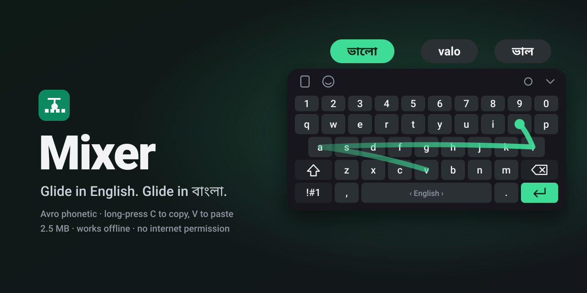

<p align="center">
  
</p>

<p align="center">
  <b>One keyboard for English and বাংলা.</b><br>
  Samsung-style glide typing, Avro phonetic Bangla, and Ridmik's long-press copy &amp; paste, in a 2.5 MB app that never touches the internet.
</p>

<p align="center">
  
  
  
  
</p>

---

## Why Mixer?

If you write in both English and Banglish, you probably switch keyboards all day: one for glide typing in English, another (Ridmik, Avro) for Bangla. Mixer puts both in one keyboard and switches with a swipe of the space bar.

## Features

| | |
|---|---|
| ✍️ **Glide typing in English** | Swipe across letters and the word appears, with a visible trail and alternatives in the strip. |
| 🇧🇩 **Glide typing in Bangla** | Swipe `valo` and get **ভালো**. Glide matches 60,000 real Bangla words directly, so capital letters (ত vs ট) never need guessing. |
| 🔤 **Avro phonetic** | Tap-type Banglish as you always have: `ami banglay gan gai` → আমি বাংলায় গান গাই. A faithful port of Avro's rules and dictionary. |
| 📋 **Long-press C / V** | Long-press **C** to copy the selection (or the whole box), **V** to paste, **X** to cut, **A** to select all. There's also a clipboard history panel. |
| 🌐 **Swipe space to switch** | Swipe the space bar left or right to switch between English and বাংলা. Hold it, then slide, to move the cursor. |
| 😀 **Emoji** | The toolbar button or a long-press on Enter. Recents and skin tones; only emoji your phone can show are listed. |
| 🧠 **Learns from you** | Autocorrect, next-word suggestions, and a glide word picker that tunes itself from the words you pick. |
| 📐 **Samsung layout** | 43dp keys, 35dp number row, 5dp/8dp gaps, touch areas that meet edge to edge, and adaptive touch. Every size is adjustable. |
| 🔒 **Private** | No internet permission at all. Learned words and the glide log stay on your phone. |

## Gestures cheat sheet

| Do this | Get this |
|---|---|
| Swipe across letters | Glide-type a word (English or Bangla) |
| Swipe the **space bar** ← / → | Switch English ⇄ বাংলা |
| **Hold** space, then slide | Move the cursor |
| Long-press **C / V / X / A** | Copy / paste / cut / select all |
| Long-press **Enter** | Emoji panel |
| Swipe left from **⌫** | Delete whole words |
| Backspace right after an autocorrect | Undo it |
| Long-press a key | Accents and symbols (`৳ $ € £`, `é`, `½` …) |
| Tap **⇧** twice | Caps lock |

## Install (alpha testers)

1. Download **`Mixer-<version>.apk`** from the [Releases](../../releases) page on your phone.
2. Open it. If Android asks, allow installing apps from this source (your browser or Files app).
3. Open the **Mixer** app, tap **Enable Mixer**, then **Switch to Mixer**.
4. Tap any text box and start typing. Swipe the space bar to try বাংলা.

> To switch back to your old keyboard, tap the keyboard icon in the navigation bar, or go to *Settings → General management → Keyboard list* (Samsung).

## Bangla glide: how it picks the word

A swipe can't carry capital letters, and in Avro case matters (`t` = ত, `T` = ট). So Mixer never guesses the Banglish spelling. It matches your swipe straight against Bangla words:

```
 swipe  v → a → l → o
          │
          ▼  each Bangla word has natural swipe spellings
 ভালো  valo · bhalo        ভাল  valo · bhal       ভাল্ব  valb
          │
          ▼  ranked by  shape match + word frequency + your history
 ভালো (in the text)   ·   ভাল  ·  ভালোও  ·  …  (one tap away)
```

Every glide is scored, and the outcome is recorded: did you keep the default, pick another, or delete it? Picking another word nudges the ranking weights towards your choice. You can see the hit rate under **Mixer → Glide word picker**, and export the last 500 glides to help tune it.

## Settings

Open the **Mixer** app (or the ⚙ button on the keyboard):

- Glide typing (English / Bangla), autocorrect, auto-capitalise, double-space full stop
- Number row, key preview, sound, vibration (off / light / normal / strong), theme (system / light / dark)
- Layout: letter key height, number row height, key gap, row gap, toolbar height, adaptive touch, and **Reset to Samsung defaults**
- Glide word picker stats, export / clear the log, reset learned ranking
- Test boxes for every input type (text, password, email, URL, number, phone)

## Build from source

Mixer is plain Kotlin and Android Views: no Compose, no AndroidX, no native code.

**Requirements:** JDK 17 and the Android SDK (platform 36, build-tools 35).

```bash
# Windows, with the toolchain unpacked into .tools/ (see gw.cmd)
gw.cmd assembleRelease          # → app/build/outputs/apk/release/app-release.apk
install-phone.cmd               # build + install over USB + select the keyboard

# Anywhere else
./gradlew assembleRelease       # with JAVA_HOME and ANDROID_HOME set
./gradlew testDebugUnitTest     # Avro, autocorrect, English + Bangla glide tests
```

The dictionaries in `app/src/main/assets` are generated by `scripts/build_assets.js` from the sources listed in [NOTICE.md](NOTICE.md).

<details>
<summary><b>Project layout</b></summary>

```
app/src/main/java/dev/banglish/keyboard/
├── KeyboardService.kt      IME lifecycle, typing, composing, clipboard tricks
├── KeyboardView.kt         Canvas-drawn keys, multi-touch, long-press, glide capture
├── CandidateView.kt        suggestion strip / toolbar
├── layout/Layouts.kt       QWERTY, symbols, number pad
├── glide/                  glide classifier, Bangla glide lexicon, pick log + self-tuning
├── bangla/                 Avro phonetic engine + Avro dictionary suggestions
├── suggest/                English dictionary, autocorrect, learned words
├── emoji/  clip/           emoji panel, clipboard history
└── SetupActivity.kt        setup, settings, stats, test boxes
scripts/build_assets.js     builds the word lists from the open-source data
```
</details>

## Credits

Mixer stands on great open work:

- **Avro Phonetic** rules, Bangla dictionary and autocorrect © OmicronLab, via jsAvroPhonetic / ibus-avro (MPL-2.0)
- **English word list** from the AOSP / OpenBoard dictionaries (Apache-2.0)
- **Bangla word frequencies** from [wordfreq](https://github.com/rspeer/wordfreq) by Robyn Speer et al. (CC BY-SA 4.0)
- **Glide matching**: the SHARK² shape-matching approach, as used by FlorisBoard
- **Emoji data** from Unicode

Full details in [NOTICE.md](NOTICE.md).
